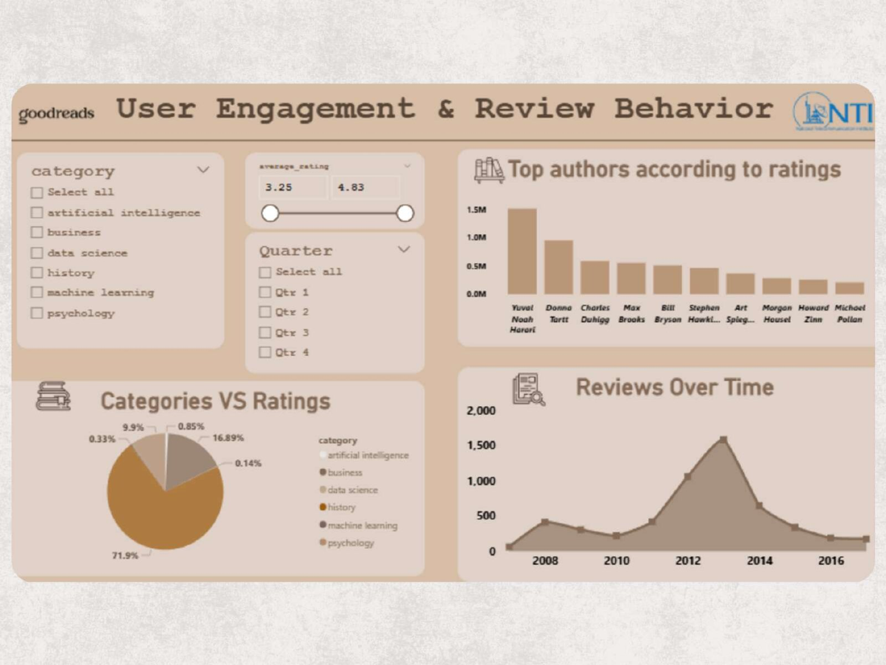
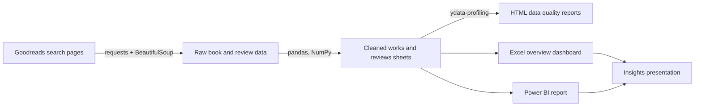
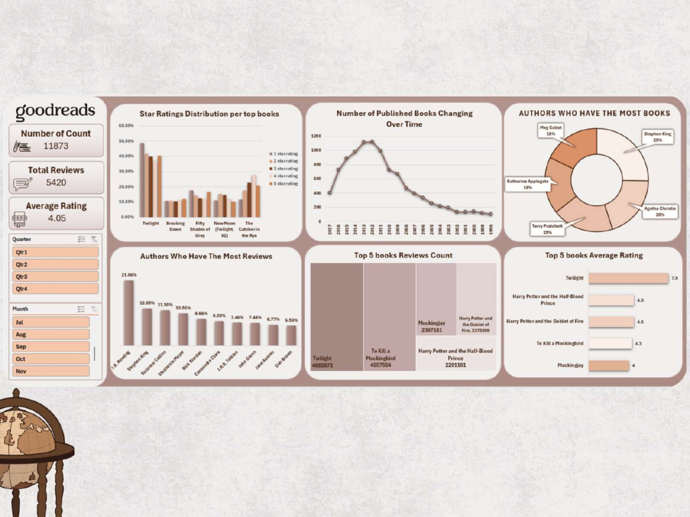

# Goodreads Data Analysis: From Scraping to Insights

An end-to-end analytics project on book and review data from Goodreads: web scraping with Python, data cleaning and profiling with pandas, then interactive dashboards in Excel and Power BI.


> **Team project** completed during the NTI Data Analysis training program. Original repository by Farah Balba'a; this is my fork.



## Problem

Goodreads holds millions of titles, ratings and reviews, but the data is spread across web pages. The goal was to collect it, clean it into analysis-ready tables, and find out which books, authors and genres drive reader engagement and how activity changes over time.

## Workflow



1. **Scraping** ([`Scraping_Notebook.ipynb`](Python%20Notebooks/Scraping_Notebook.ipynb)): searches Goodreads for six categories (data science, machine learning, artificial intelligence, business, history, psychology), reads up to five result pages per query, and collects title, author, average rating, number of ratings and book URL. It uses a session with automatic retries and polite delays between requests.
2. **Cleaning** ([`Works_Cleaning_Notebook.ipynb`](Python%20Notebooks/Works_Cleaning_Notebook.ipynb), [`Reviews_Cleaning_Notebook.ipynb`](Python%20Notebooks/Reviews_Cleaning_Notebook.ipynb)): fixes data types, parses dates, fills or removes missing values, validates and converts ISBN-10 to ISBN-13, drops unused columns and exports the clean sheets.
3. **Profiling** ([`Python Reports/`](Python%20Reports)): ydata-profiling reports for the works and reviews datasets.
4. **Dashboards** ([`Dashboards/`](Dashboards)): an Excel overview dashboard and a Power BI report on user engagement and review behaviour.
5. **Presentation** ([`Goodreads Analysis pdf.pdf`](Goodreads%20Analysis%20pdf.pdf)): the full story from scraping to insights.

## Key insights

From the project presentation:

- **Twilight** stands out among the top books: it has the highest concentration of 5-star ratings and leads in both review count and average rating.
- Published books in the dataset **peak between 2012 and 2014** and decline sharply after 2015.
- **J.K. Rowling** holds the largest share of reviews (about 21%); **Stephen King** and **Agatha Christie** lead in number of books (25% and 20%).
- Review activity peaks around **2013** and drops to a very low point by 2014.
- A small number of authors account for a large part of all reviews.



## Tech stack

| Stage | Tools |
|---|---|
| Collection | Python, requests (with retries), BeautifulSoup, lxml |
| Cleaning | pandas, NumPy, Google Colab |
| Profiling | ydata-profiling |
| Visualization | Excel, Power BI |

## Repository structure

```
Python Notebooks/   Scraping and cleaning notebooks
Python Reports/     ydata-profiling HTML reports
Cleaned Dataset/    Cleaned data (zip)
Dashboards/         Power BI report (.pbix) and Excel overview dashboard
Dataset.zip         Raw dataset (stored with Git LFS)
Goodreads Analysis pdf.pdf   Project presentation
images/             Screenshots used in this README
```

## How to run

1. Open the notebooks in [Google Colab](https://colab.research.google.com/) or Jupyter.
2. Install dependencies: `pip install requests beautifulsoup4 lxml pandas numpy ydata-profiling openpyxl tqdm`.
3. Run `Scraping_Notebook.ipynb`, then the two cleaning notebooks.
4. Open `Dashboards/Dataset Report.pbix` in Power BI Desktop or `Dashboards/Overview Dashboard.xlsx` in Excel.

> `Dataset.zip` is stored with Git LFS. Clone with Git LFS installed (`git lfs install`) to download the actual file.

## Team

- Farah Balba'a and team (original repository)
- [Lina Amer](https://github.com/LinaAmer12)

---

📫 Lina Amer · [LinkedIn](https://www.linkedin.com/in/linaamer1) · [linaamer1312@gmail.com](mailto:linaamer1312@gmail.com)
